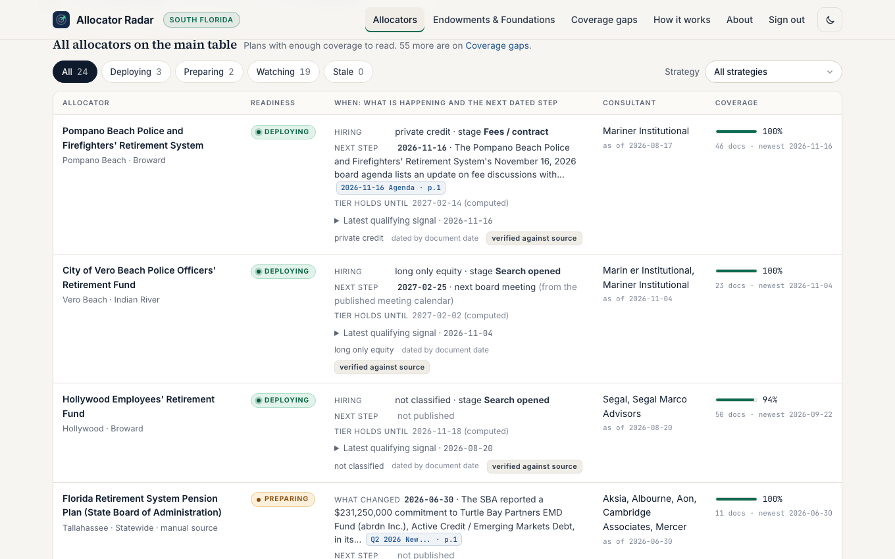
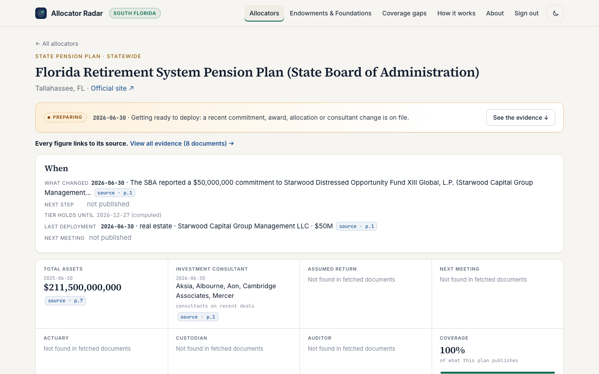
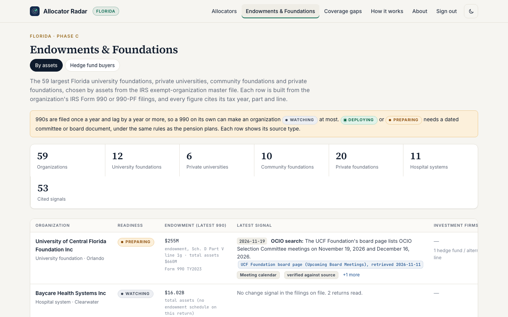
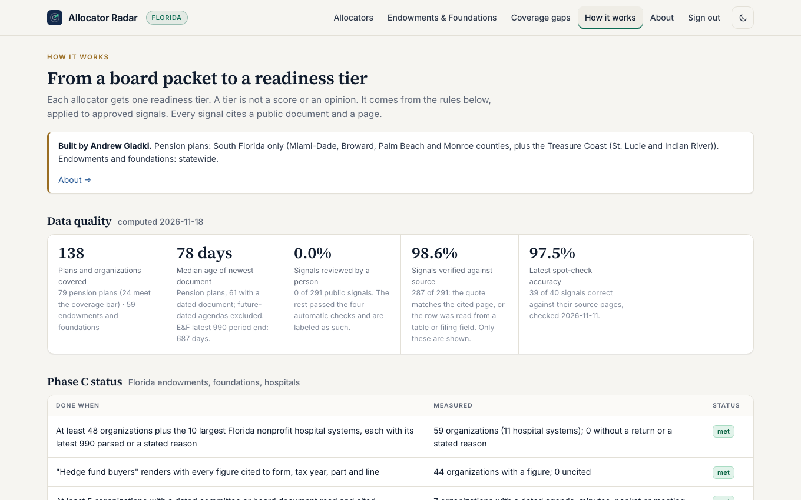

# Allocator Radar

**Which Florida institutional allocators are getting ready to put money to work, and the public document that says so.**

Live overview: **[allocator.amagna.co](https://allocator.amagna.co/)** (the full tool is available to invited users).

Pension boards, endowments and foundations record their investment decisions in their own paperwork: a vote to
search for a new private-credit manager, a raised target allocation, a newly adopted asset-liability study, a
commitment to a fund. All of it is public record, but it is spread across hundreds of agenda packets, minutes,
investment reports and IRS filings that nobody reads in full. Allocator Radar reads them. It gives each allocator one
readiness tier and links every tier to the dated page of the document that set it.

For an institutional business development team, that answers two questions: which allocators to call this month,
and what in the public record shows why.

This repository is the public write-up: what the system does, how it works at a high level, its data-quality
figures, screenshots, and a small sample of verified signals with their public sources. The pipeline code and the
databases are private.

## Screenshots

<table>
  <tr>
    <td width="50%"></td>
    <td width="50%"></td>
  </tr>
  <tr>
    <td>The allocator table. One readiness tier per plan, the signal behind it, the consultant and the coverage.</td>
    <td>A plan page. Every figure links to its source document and page.</td>
  </tr>
  <tr>
    <td width="50%"></td>
    <td width="50%"></td>
  </tr>
  <tr>
    <td>Endowments and foundations. Figures from IRS Form 990 filings, cited to tax year, part and line.</td>
    <td>How it works, with the data-quality scorecard computed at every build.</td>
  </tr>
</table>

## What it does

- **Reads public documents.** Board agendas, minutes, investment performance reports, investment policy statements,
  audited financial statements and IRS Form 990 / 990-PF filings, from the allocators' own public websites and
  public government data.
- **Extracts dated signals.** A manager search opened, an RFP issued, finalists named, a mandate awarded or funded, a
  commitment made, a target allocation changed, an investment policy amended, a consultant changed, a manager
  terminated, an asset-liability or pacing study adopted.
- **Verifies every signal against its source.** A signal is shown only if the quoted passage matches the cited page
  (or the value was read from a table or filing field), its date is the one printed in the document, and it passes
  automatic consistency checks.
- **Sets one readiness tier per allocator** from fixed, published rules, never from a score or an opinion:

| Tier | Rule |
|---|---|
| DEPLOYING | A manager search or RFP is open, finalists were named, or a mandate was awarded in the last 90 days |
| PREPARING | In the last 180 days: target allocation raised, IPS amended, asset-liability or pacing study adopted, consultant changed, or an incumbent placed on watch or terminated |
| WATCHING | A new document was fetched in the last 120 days, but no qualifying signal is in the window |
| STALE | No new document in 120 days. This describes coverage, not the allocator |

- **Highlights hedge fund activity**: searches, hires, terminations and target changes for hedge fund, absolute
  return, risk-mitigation, managed futures and diversifying-strategy mandates.

## How it works, at a high level

1. **Registry.** A curated list of allocators and the public pages each one publishes documents on. Only those
   pages are fetched.
2. **Polite collection.** Read-only GET requests to allowlisted public pages, honoring robots.txt. Nothing behind a
   login, no forms, no bot-wall workarounds; sources whose terms forbid automation are collected by hand.
3. **Parsing.** PDFs, scanned pages (local OCR), HTML and IRS e-file XML become page-addressed text, so every
   later claim can point to a page.
4. **Extraction.** A language model proposes signals, consultants, managers and officers, each with the exact quote
   and page it came from.
5. **Verification.** Deterministic checks confirm each quote against the stored page, fix the date basis, and lint
   the result. Anything that fails is held back and never published.
6. **Readiness.** The tier rules above run over verified signals only.
7. **Publishing.** A static site build, checked by an automated publishing gate before every deploy.

Every line in the product cites a public document and page. People appear by name and title only as the cited
document prints them.

## Phases

| Phase | Scope | Status |
|---|---|---|
| A | South Florida public pension plans (Miami-Dade, Broward, Palm Beach, Monroe, plus the Treasure Coast) and the Florida Retirement System (State Board of Administration) | Done |
| B | Every Florida local pension plan collected into the registry | Done (the product shows South Florida) |
| C | The largest Florida endowments, foundations and nonprofit hospital systems, from IRS 990 filings and their own committee documents | Current: 59 organizations, 11 of them hospital systems |
| D–J | All Florida local plans in the product; corporate and union plans (DOL Form 5500); managers, consultants and OCIOs (SEC filings); insurers and family offices; national coverage | Planned |

## Data quality

Computed by the system at build time (2026-11-18), shown on the tool's *How it works* page:

| Measure | Value |
|---|---|
| Allocators covered | 138: 79 public pension plans (24 meet the coverage bar for the main table) and 59 endowments and foundations |
| Pension board documents read | 1,027 |
| Signals verified against source | **98.6%**: 287 of 291 public signals (the quote matches the cited page, or the row was read from a table or filing field). Only verified signals are shown |
| Latest spot-check accuracy | **97.5%**: 39 of 40 signals correct against their source pages, checked by hand on 2026-11-11 |
| Median age of the newest document | 78 days (pension plans) |
| Signals reviewed by a person | 0%: the rest passed the automatic checks, and every row in the product is labeled with how it was approved |

## Sample data

[`sample/verified_signals_sample.csv`](sample/verified_signals_sample.csv): 25 verified signals from 18 South
Florida public pension plans, with the public source document, its URL and page, and the verification checks
each one passed.

| Column | Meaning |
|---|---|
| `allocator`, `county` | The pension plan |
| `signal_type` | e.g. `SEARCH_SCHEDULED`, `FINALISTS_NAMED`, `MANDATE_AWARDED`, `COMMITMENT_MADE`, `REBALANCE_APPROVED`, `IPS_AMENDED` |
| `asset_class` | The mandate's asset class or strategy, where the document states it |
| `event_date` | The date printed in the source (meeting, notice or filing date), never the fetch date |
| `summary` | One sentence describing what the document records |
| `source_document`, `source_url`, `page` | The public document, where to get it, and the page the signal is on |
| `verification` | The automatic checks the signal passed |

The sample holds no contact details and names firms only. Open any `source_url` to check a row yourself.

## Stack

Python, DuckDB, FastAPI and Jinja for the local app, page-addressed document storage, local OCR, a pluggable
language-model backend for extraction, and Cloudflare Workers for the published site.

## Built by

**Andrew Gladki.** I want to work on the institutional business development team of a large
financial institution. This project shows what I would bring: AI engineering, data analytics, an understanding of
how institutional capital moves, and the ability to take a complex, open-ended problem to an accurate, working
solution quickly.

Request access to the full tool from [allocator.amagna.co](https://allocator.amagna.co/#access).
